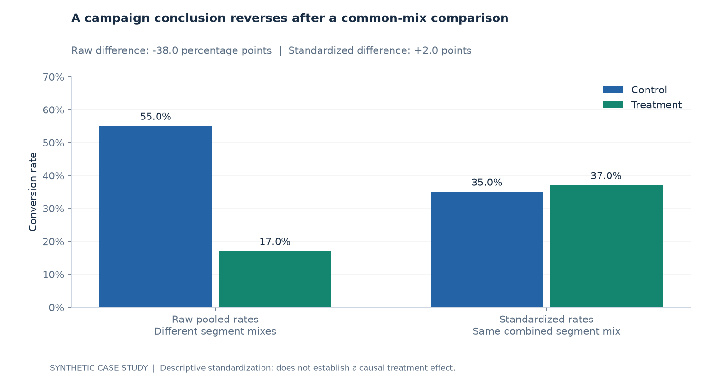

# Leo Li · Business Analytics Portfolio

Twenty-three runnable case studies connecting securities operations, retail CRM, financial education, basketball, and golf. Built with Python's standard library, with SQLite examples for operational KPIs, retention cohorts, revenue bridges, and campaign mix adjustment.

These are independent portfolio prototypes built with synthetic data. They are not past employer systems, production deployments, or evidence of realized business impact. The code is intended to be inspected, tested, and extended.

## Start here

```sh
python3 run_all.py
python3 -m unittest discover -s tests -v
```

Requires Python 3.10 or newer. No pip installation, network connection, credentials, or paid service is needed. Each project also runs independently with `python3 app.py` from its own directory. Output paths default to the project directory; pass `--output` to save elsewhere.

## Projects

| Project | Business question |
| --- | --- |
| [Securities Reconciliation Engine](projects/01-securities-reconciliation/README.md) | Which transaction breaks should operations investigate before settlement? |
| [Settlement SLA and Bottleneck Analysis](projects/02-settlement-sla/README.md) | Where does a settlement workflow lose time? |
| [Automation Opportunity Scorecard](projects/03-automation-prioritization/README.md) | Which workflow changes deserve a pilot, and which fail control gates? |
| [Retail Customer Lifecycle Segmentation](projects/04-retail-rfm/README.md) | Which customers should a CRM team retain, reactivate, or develop? |
| [Monthly Purchase Retention Cohorts](projects/05-retention-cohorts/README.md) | Do newly acquired customers return in later months? |
| [Campaign A/B Test Readout](projects/06-campaign-experiment/README.md) | Does a campaign change conversion enough to justify a follow-up experiment? |
| [CRM Identity Quality Audit](projects/07-crm-identity-quality/README.md) | Which member records can be linked exactly and which need manual review? |
| [Financial Education Savings Simulator](projects/08-savings-scenarios/README.md) | How do contributions, compounding, fees, and inflation change a hypothetical savings path? |
| [Basketball Shot Profile Analytics](projects/09-basketball-shot-profile/README.md) | Which shot zones combine efficiency and enough attempts to merit attention? |
| [Golf Round Performance Review](projects/10-golf-round-review/README.md) | Which parts of a round deserve focused practice? |
| [Payment Settlement Ledger](projects/11-payment-settlement-ledger/README.md) | Do processor payouts reconcile to captured sales, refunds, and fees? |
| [Subscription Revenue Bridge](projects/12-subscription-revenue-bridge/README.md) | What explains the change in monthly recurring revenue? |
| [Ordered Checkout Funnel](projects/13-ordered-checkout-funnel/README.md) | At which step do sessions stop progressing through checkout? |
| [Acquisition Channel Contribution](projects/14-acquisition-unit-economics/README.md) | Does a high-revenue acquisition channel still contribute after refunds and variable costs? |
| [Inventory Reorder Policy Simulator](projects/15-inventory-reorder-policy/README.md) | When does inventory position justify a replenishment review, and how does case packing change the quantity? |
| [Demand Forecast Backtest](projects/16-demand-forecast-backtest/README.md) | Which simple demand baseline generalizes to a held-out week? |
| [Service Queue Capacity Simulator](projects/17-service-queue-simulation/README.md) | How does parallel handling capacity change waiting time under the same observed workload? |
| [UAT Requirements Traceability](projects/18-uat-release-readiness/README.md) | Which unmet requirements block a release recommendation? |
| [Counterparty Exposure Concentration](projects/19-counterparty-concentration/README.md) | How concentrated are gross exposures after related entities are grouped? |
| [Campaign Mix and Simpson Reversal](projects/20-campaign-mix-adjustment/README.md) | Does a campaign conclusion reverse when both variants use the same customer mix? |
| [Suspense Account Aging](projects/21-suspense-account-aging/README.md) | Which unmatched cash postings still need investigation at month end? |
| [CRM Contact Eligibility Audit](projects/22-crm-contact-eligibility/README.md) | Which members meet a campaign’s consent and seven-day contact rules? |
| [Retail Basket Affinity](projects/23-retail-basket-affinity/README.md) | Which product pairs occur together more often than their individual frequencies imply? |

## Featured case study



The synthetic campaign looks worse in aggregate but better within each segment. [Inspect the mix-adjustment case](projects/20-campaign-mix-adjustment/README.md) to see why the denominator and customer mix change the conclusion.

[Read the second-batch findings and interview prompts](BATCH_2_CASE_NOTES.md).

## Suggested review order

Start with **Securities Reconciliation** to inspect exception handling and monetary precision. Follow with **Campaign A/B Test Readout** for statistical assumptions and guardrails, then **Retention Cohorts** for denominator discipline and SQL/Python parity. Basketball and golf add personal context and demonstrate transferring analytical methods to another domain.

Every folder includes a documented input schema, synthetic CSV fixture, executable analysis, and reproducible JSON output. Seven folders include SQLite queries. The tests cover business boundaries, duplicate handling, sparse experiments, date boundaries, financial arithmetic, SQL parity, and CLI reproducibility.

## Repository layout

- `projects/`: twenty-three self-contained case studies.
- `tests/`: business-rule and end-to-end tests.
- `run_all.py`: regenerate all bundled results.
- `catalog.json`: machine-readable project index.
- `.github/workflows/ci.yml`: GitHub Actions checks for Python 3.10 and 3.13.
- `START_HERE_ZH.md`: Chinese walkthrough and publication status.

## Optional chart regeneration

The four PNG previews are already committed. Analysis and tests remain dependency-free. Only regenerating charts requires Python 3.11+ and Matplotlib:

```sh
python3 -m venv .venv
.venv/bin/python -m pip install -r requirements-visuals.txt
.venv/bin/python render_previews.py
```

The figures read committed `results.json` files. Run `python3 run_all.py` first if the sample data changed.

## Evidence and limitations

The expanded suite contains 57 test methods, including integration checks over all 23 projects. Local validation used Python 3.13.6. GitHub Actions runs the suite on Python 3.10 and 3.13; see the repository Actions tab for the latest status. Floating-point comparisons allow only a tight tolerance for platform math-library rounding differences. Bundled data is intentionally small enough to inspect; it is not a performance benchmark. Input validation is suitable for these prototypes, not a full production ingestion or security boundary. Do not load sensitive records into a public repository.

## Development priorities

1. Reconciliation: multi-currency keys, input schemas, reviewer audit trails, larger benchmark fixtures.
2. Marketing: randomized user-level observations, power planning, campaign eligibility and consent rules.
3. Retention: completeness checks, acquisition sources, and gross-margin outcomes.
4. Sports: shot-level context, real licensed datasets, and interactive visual exploration.

No real employer data, résumé contact details, or proprietary code is included. No third-party dataset is required. No open-source license has been selected yet.
