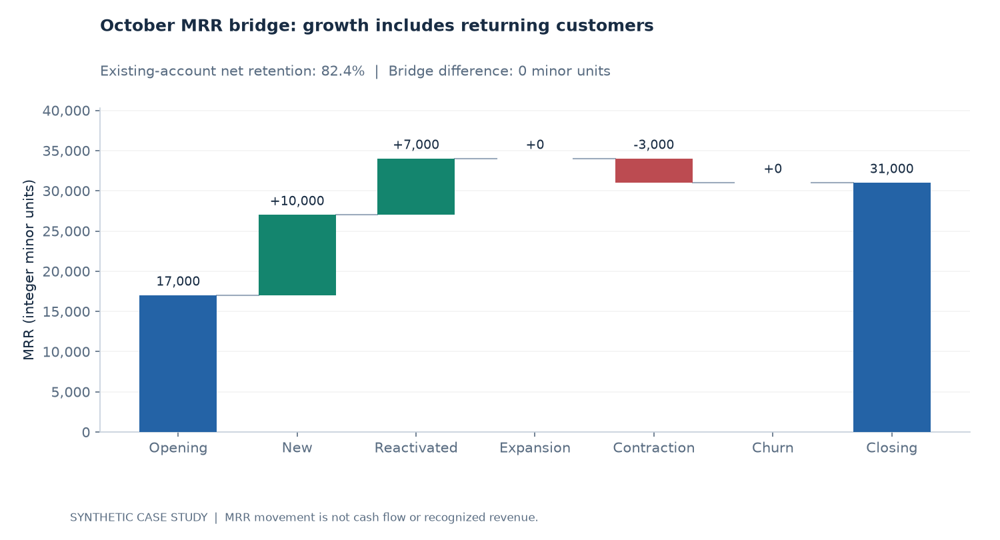

# Subscription Revenue Bridge

What explains the change in monthly recurring revenue?



The preview is generated from `results.json`. Regenerate it with the optional root `render_previews.py` script.

## Business context

Connects KPI reporting with SaaS and fintech business operations. This independent portfolio case uses invented records. It is not a former employer's system or a claim of production impact.

## Run and inspect

Python 3.10+; no third-party libraries, accounts, or network calls.

```sh
python3 app.py
python3 app.py --input sample.csv --output results.json
```

Run from this folder, or pass the full path to `app.py` from elsewhere. The default input and output resolve beside the script. `results.json` is the reproducible sample output. The portfolio root test command is `python3 -m unittest discover -s tests -v`.

## Data contract

CSV headers must match the following names and order. Empty inputs, missing columns, malformed row widths, invalid values, and duplicate logical keys fail with exit code 2. Money, where present, is stored in integer minor units to avoid currency rounding errors. No live or private data is included.

| Column | Definition |
| --- | --- |
| `customer_id` | Synthetic customer; every customer must have a row in every month |
| `month` | YYYY-MM consecutive calendar months |
| `mrr_cents` | Nonnegative monthly recurring revenue; 0 explicitly marks inactivity |

## Method

Builds a conserved MRR bridge: opening + new + reactivation + expansion − contraction − churn = closing. Net revenue retention includes only accounts with positive opening MRR. “New” means no prior paid month within this supplied history; reactivation means a previously paid account returns. Full rectangular snapshots prevent missing data from silently becoming churn.

## SQL companion

`analysis.sql` implements the core aggregation in SQLite against a table named `snapshots` with the CSV column names. Run Python input validation before applying the query to external data. Tests load the fixture into an in-memory database and compare SQL results against Python.

## Acceptance criteria

- Bridge difference must be zero in every month.
- Returning customers must not inflate new MRR.
- Missing months and missing customer snapshots fail validation.

## Limitations and next iteration

This is contracted recurring revenue, not cash receipts or accounting revenue recognition. History before the baseline is unknown. Does not prorate partial months or handle FX. Next: subscription-event ingestion and historical customer status.

Use this case to explain the business question, metric definitions, exception handling, and assumptions in an interview. Any result is about the synthetic fixture only.
