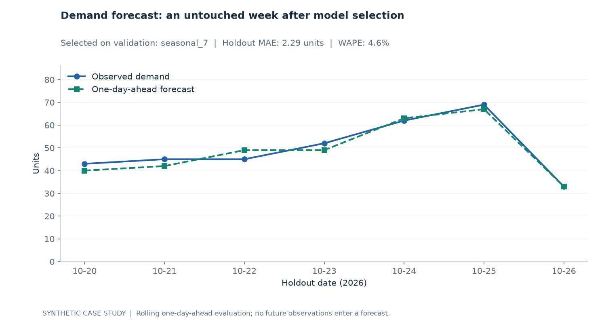

# Demand Forecast Backtest

Which simple demand baseline generalizes to a held-out week?



The preview is generated from `results.json`. Regenerate it with the optional root `render_previews.py` script.

## Business context

Builds a forecasting case with explicit protection against future-data leakage. This independent portfolio case uses invented records. It is not a former employer's system or a claim of production impact.

## Run and inspect

Python 3.10+; no third-party libraries, accounts, or network calls.

```sh
python3 app.py
python3 app.py --input sample.csv --output results.json
```

Run from this folder, or pass the full path to `app.py` from elsewhere. The default input and output resolve beside the script. `results.json` is the reproducible sample output. The portfolio root test command is `python3 -m unittest discover -s tests -v`.

## Data contract

CSV headers must match the following names and order. Empty inputs, missing columns, malformed row widths, invalid values, and duplicate logical keys fail with exit code 2. Money, where present, is stored in integer minor units to avoid currency rounding errors. No live or private data is included.

| Column | Definition |
| --- | --- |
| `date` | Unique ISO calendar date; consecutive daily observations |
| `units` | Nonnegative integer observed demand |

## Method

Uses an initial training period of at least 14 days, then 7 validation days and 7 untouched holdout days. Selects among last value, same weekday last week, and a 7-day moving mean by validation MAE, with stable listed-order tie breaking. Holdout forecasts are rolling one-day-ahead predictions: each uses only observations strictly before its date. Reports MAE and WAPE; WAPE is null for an all-zero actual window.

## Acceptance criteria

- Future holdout values cannot affect model selection or earlier predictions.
- Gaps and duplicate dates fail validation.
- All-zero demand does not produce divide-by-zero errors.

## Limitations and next iteration

One synthetic series does not establish a generally superior model. The holdout is one-step walk-forward, not a seven-day forecast made at one origin. No promotions or external features are included. Next: more forecast origins, prediction intervals, and asymmetric stockout costs.

Use this case to explain the business question, metric definitions, exception handling, and assumptions in an interview. Any result is about the synthetic fixture only.
