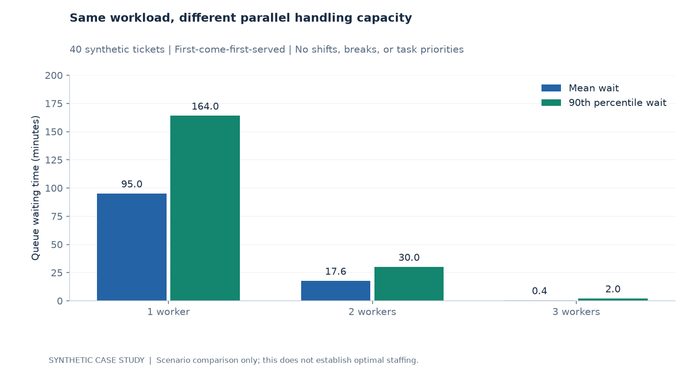

# Service Queue Capacity Simulator

How does parallel handling capacity change waiting time under the same observed workload?



The preview is generated from `results.json`. Regenerate it with the optional root `render_previews.py` script.

## Business context

Extends workflow bottleneck analysis into a reproducible discrete-event scenario. This independent portfolio case uses invented records. It is not a former employer's system or a claim of production impact.

## Run and inspect

Python 3.10+; no third-party libraries, accounts, or network calls.

```sh
python3 app.py
python3 app.py --input sample.csv --output results.json
```

Run from this folder, or pass the full path to `app.py` from elsewhere. The default input and output resolve beside the script. `results.json` is the reproducible sample output. The portfolio root test command is `python3 -m unittest discover -s tests -v`.

## Data contract

CSV headers must match the following names and order. Empty inputs, missing columns, malformed row widths, invalid values, and duplicate logical keys fail with exit code 2. Money, where present, is stored in integer minor units to avoid currency rounding errors. No live or private data is included.

| Column | Definition |
| --- | --- |
| `ticket_id` | Unique synthetic work item |
| `arrival_minute` | Nonnegative arrival time from the start of the observation window |
| `service_minutes` | Positive uninterrupted handling duration |
| `wait_sla_minutes` | Nonnegative allowed queue wait before service |

## Method

Uses a heap of worker availability times. Each arrival goes to the earliest-free worker; ties use worker index. Reports mean and nearest-rank p90 wait, strict wait-SLA breach rate, and busy fraction over [0, last completion]. Identical jobs are replayed with one, two, and three workers. A per-ticket schedule makes the simulation auditable.

## Acceptance criteria

- No ticket starts before arrival or before its assigned worker is free.
- SLA equality is not a breach.
- Schedules conserve the number of tickets and service durations.

## Limitations and next iteration

Assumes identical continuously available workers, known service times, no priorities or interruptions, and no abandonment. This compares scenarios; it does not establish optimal staffing or labor cost. Next: shifts, skill routing, and uncertainty in arrivals.

Use this case to explain the business question, metric definitions, exception handling, and assumptions in an interview. Any result is about the synthetic fixture only.
