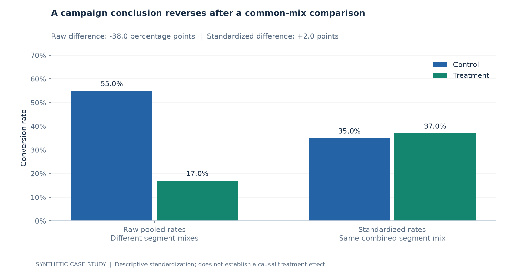

# Campaign Mix and Simpson Reversal

Does a campaign conclusion reverse when both variants use the same customer mix?



The preview is generated from `results.json`. Regenerate it with the optional root `render_previews.py` script.

## Business context

Builds on marketing experiments with an explicit confounding demonstration. This independent portfolio case uses invented records. It is not a former employer's system or a claim of production impact.

## Run and inspect

Python 3.10+; no third-party libraries, accounts, or network calls.

```sh
python3 app.py
python3 app.py --input sample.csv --output results.json
```

Run from this folder, or pass the full path to `app.py` from elsewhere. The default input and output resolve beside the script. `results.json` is the reproducible sample output. The portfolio root test command is `python3 -m unittest discover -s tests -v`.

## Data contract

CSV headers must match the following names and order. Empty inputs, missing columns, malformed row widths, invalid values, and duplicate logical keys fail with exit code 2. Money, where present, is stored in integer minor units to avoid currency rounding errors. No live or private data is included.

| Column | Definition |
| --- | --- |
| `segment` | Predefined customer segment |
| `variant` | control or treatment; both required for every segment |
| `users` | Positive number of users in the cell |
| `conversions` | Nonnegative conversions no greater than users |

## Method

First computes the raw pooled conversion rates. Then applies the same reference weights to each variant: each segment receives its share of combined control-plus-treatment users. The weighted within-segment difference is compared with the raw difference, and opposite signs trigger a direction-reversal flag. No significance or causal claim is made.

## SQL companion

`analysis.sql` implements the core aggregation in SQLite against a table named `cells` with the CSV column names. Run Python input validation before applying the query to external data. Tests load the fixture into an in-memory database and compare SQL results against Python.

## Acceptance criteria

- Common weights sum to one and are identical across variants.
- Missing counterpart cells fail validation.
- Splitting a segment into proportional subsegments preserves the standardized result.

## Limitations and next iteration

Segments must be mutually exclusive, exhaustive, and defined before examining outcomes. Adjustment cannot remove unmeasured confounding or bias from post-treatment segmentation. No confidence interval is provided. Next: randomized stratified allocation with predeclared weights and uncertainty estimates.

Use this case to explain the business question, metric definitions, exception handling, and assumptions in an interview. Any result is about the synthetic fixture only.
